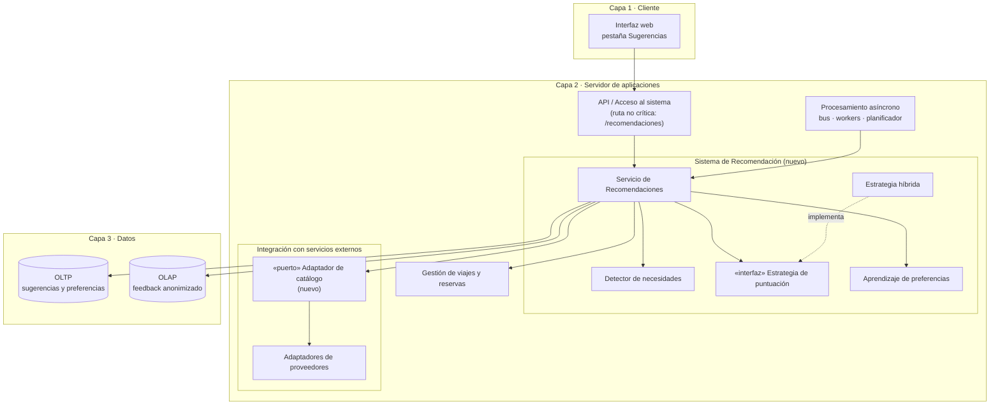
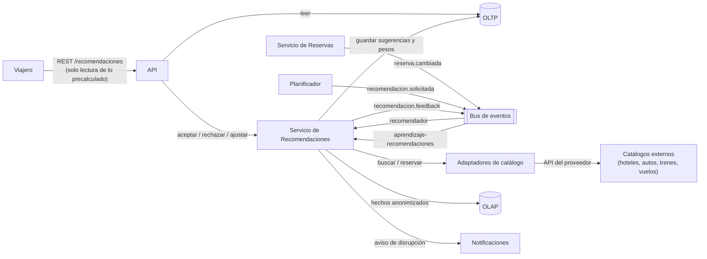
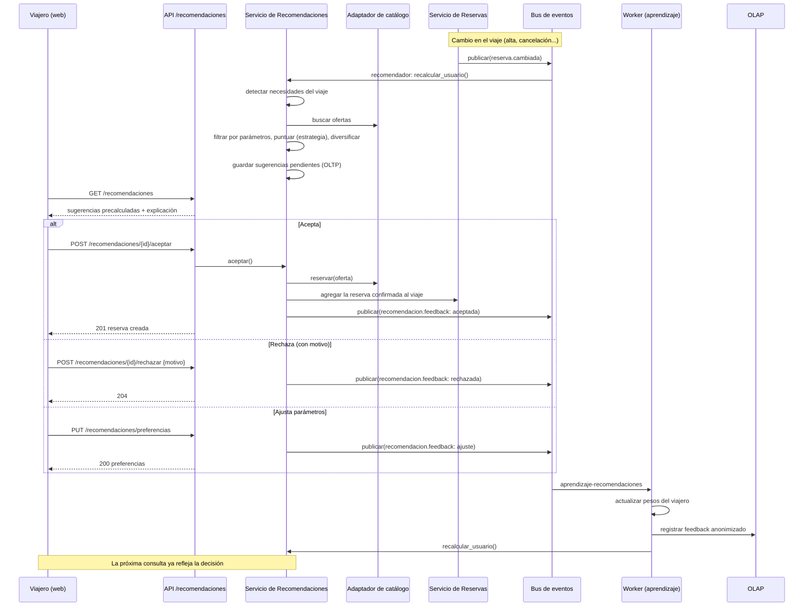

# Diagrama de módulos

El Sistema de Recomendación es un módulo nuevo de la Capa 2. Depende de la gestión de viajes (para leer el itinerario y agregar la reserva aceptada), de la integración con servicios externos (a través del nuevo puerto de catálogo) y del procesamiento asíncrono (que le entrega los eventos). El algoritmo de puntuación queda detrás de una interfaz, de modo que la estrategia híbrida se puede reemplazar sin tocar el servicio.

---

# Diagrama de componentes y conectores

Las flechas hacia y desde el bus son asíncronas; las solicitudes del viajero son síncronas pero solo leen sugerencias ya calculadas, o registran una decisión y devuelven el control de inmediato. El cálculo, la consulta a catálogos externos y el aprendizaje ocurren en los consumidores.

---

# Diagrama de secuencia: ciclo *human-in-the-loop*

El diagrama muestra el ciclo completo: el cambio en el viaje dispara el precálculo, el viajero decide y su decisión vuelve como evento para ajustar el modelo y recalcular, siempre fuera del camino de la solicitud.
