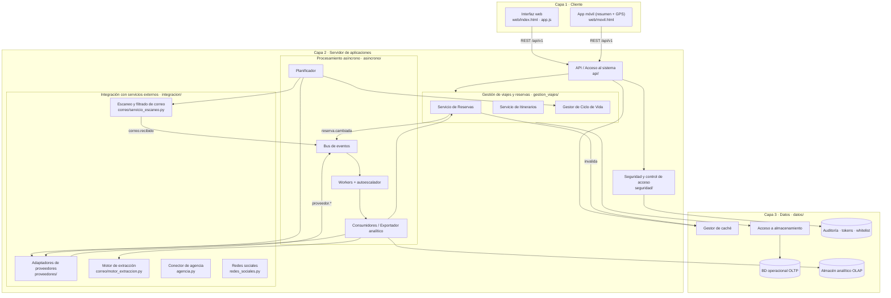
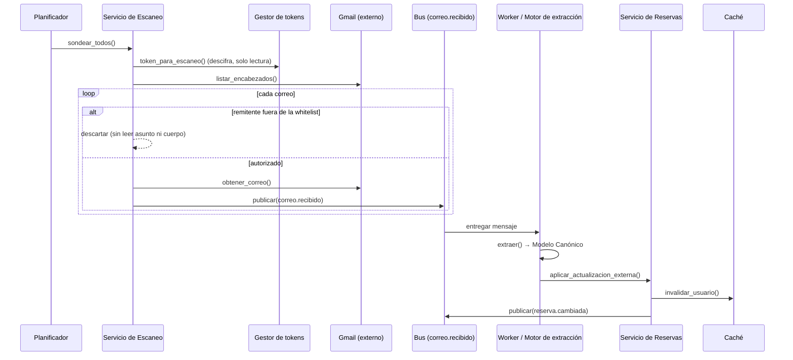
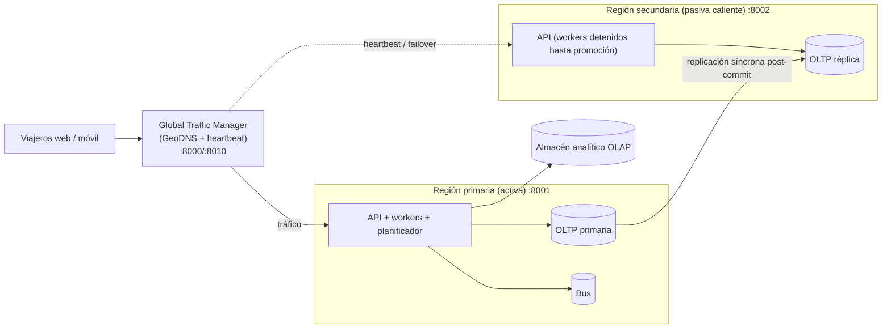

# Arquitectura implementada: del ADD al código

Este documento ubica en el código cada elemento de las vistas del ADD (`docs/add/`). Las decisiones están en los ADRs (`docs/adr/`) y los contratos en `specs/`.

Estilo (ADR-0001): **cliente-servidor con procesamiento asíncrono orientado a eventos**, organizado en tres capas.

## Vista de módulos

| Elemento del ADD | Iteración | Código |
|---|---|---|
| Interfaz web / Aplicación móvil | 1, 2, 3, 4 | `trotamundos/web/` |
| API / Acceso al sistema (API Controller) | 1, 2 | `trotamundos/api/` (`aplicacion.py`, `rutas_*.py`, `esquemas.py`) |
| Seguridad y control de acceso | 1, 3, 4 | `trotamundos/seguridad/autenticacion.py`, `autorizacion.py` |
| Gestor de tokens y seguridad de ingesta | 3 | `trotamundos/seguridad/gestor_tokens.py`, `cifrado.py` |
| Controlador de autorización de itinerarios (ACL) | 4 | `trotamundos/seguridad/autorizacion.py` |
| Registro de auditoría de accesos | 4 | `trotamundos/seguridad/auditoria.py` |
| Servicio de Reservas | 2 | `trotamundos/gestion_viajes/servicio_reservas.py` |
| Servicio de Itinerarios | 2 | `trotamundos/gestion_viajes/servicio_itinerarios.py` |
| Gestor de Ciclo de Vida | 2 | `trotamundos/gestion_viajes/gestor_ciclo_vida.py` |
| Modelo Canónico de Reserva | 3 | `trotamundos/dominio/modelo.py` |
| Adaptadores de proveedores turísticos | 3 | `trotamundos/integracion/proveedores/`, `sincronizador_proveedores.py` |
| Servicio de escaneo y filtrado de correo | 3 | `trotamundos/integracion/correo/servicio_escaneo.py`, `gmail.py` |
| Motor de extracción y parsing | 3 | `trotamundos/integracion/correo/motor_extraccion.py` |
| Conector de agencia preferida | 3 | `trotamundos/integracion/agencia.py` |
| Integración con redes sociales | 1, 4 | `trotamundos/integracion/redes_sociales.py` |
| Bus de eventos (colas de ingesta) | 1, 3 | `trotamundos/asincrono/bus_eventos.py` |
| Procesamiento en segundo plano (workers) | 1, 3, 4 | `trotamundos/asincrono/workers.py`, `consumidores.py`, `planificador.py` |
| Exportador analítico asíncrono | 4 | `trotamundos/asincrono/consumidores.py` (`exportar_analitica`) |
| Gestor de caché / Caché en memoria | 2 | `trotamundos/datos/cache.py` |
| Acceso a almacenamiento (Repositorio) | 1, 2 | `trotamundos/datos/repositorios.py` |
| Base de datos operacional (OLTP) | 1, 4 | `trotamundos/datos/base_datos.py` |
| Almacén de tokens y listas blancas | 3 | tablas `cuentas_correo` y `whitelist` (`datos/base_datos.py`) |
| Almacén de datos analítico (OLAP) | 4 | `trotamundos/datos/almacen_analitico.py` |
| Sistemas externos (Gmail, aerolíneas, hoteles, autos, trenes, agencias, red social) | Contexto | `trotamundos/integracion/simuladores.py` (simulados) |

## Vista de componentes y conectores

| Conector del ADD | Implementación |
|---|---|
| Solicitudes REST (HTTPS) | FastAPI `/api/v1`, contrato `specs/openapi.json` |
| Llamadas internas | Invocaciones entre servicios inyectados en `app.py` |
| Acceso a caché / Invalidación de caché | `GestorCache.obtener_o_calcular` / `invalidar_usuario` |
| Lectura y escritura / Acceso a base de datos | Repositorios → `BaseDatos` (SQLite) |
| Publicación de eventos / Eventos hacia el bus | `BusEventos.publicar` validando `specs/eventos/*.schema.json` |
| Mensajes asíncronos | Colas persistentes `mensajes` (entrega al menos una vez, backoff, cola de muertos) |
| APIs externas | Adaptadores (`integracion/`) → simuladores |
| Pipeline ETL / Eventos analíticos | `reserva.cambiada` → `exportador-analitico` → OLAP |
| Enrutamiento GeoDNS / Heartbeat | `infraestructura/gestor_trafico.py` → `GET /api/v1/salud` |
| Replicación entre regiones | `datos/replicacion.py` (gancho post-commit) |

### Secuencia de ingesta de correo (ADD Iteración 3)

## Vista de despliegue (ADD Iteración 4)

En el prototipo cada región es un proceso (`python -m trotamundos.infraestructura.region`), el GTM es un proxy HTTP (`python -m trotamundos.infraestructura.gestor_trafico`) y la replicación usa la API de *backup* de SQLite (ADR-0017).
